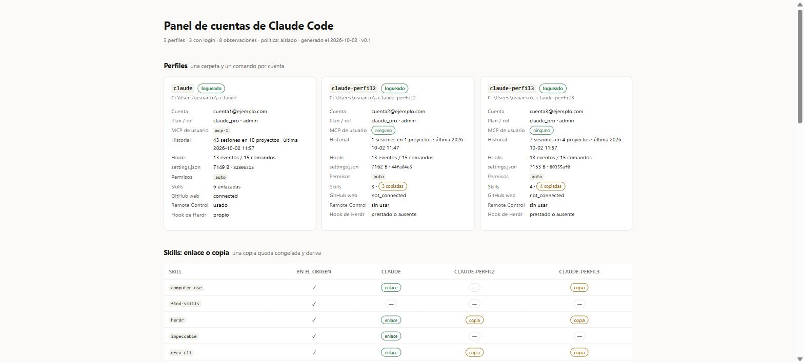

# claude-code-multicuenta

[](LICENSE)
[](#2-alta-de-un-perfil-en-un-minuto)
[](#1-qué-trae-este-repo-y-requisitos)

Correr dos o más suscripciones de Claude Code en la misma computadora, **en paralelo y sin deslogear ni relogear**, sin que una cuenta vea los servidores MCP, el historial ni las decisiones de confianza de la otra.

```text
┌─ claude            → ~/.claude            cuenta personal
├─ claude-trabajo    → ~/.claude-trabajo    cuenta de la empresa
└─ claude-cliente    → ~/.claude-cliente    cuenta de un cliente
```

Tres comandos, tres carpetas, una sola instalación de Claude Code:

- **aislamiento real de configuración:** cada perfil tiene su propio login OAuth, su propio `.claude.json` (MCP y proyectos) y su propio historial de sesiones;
- **cero programas externos:** usa la variable nativa `CLAUDE_CONFIG_DIR` acotada por proceso mediante un launcher de dos líneas;
- **aislado por defecto:** nada se comparte entre perfiles —ni skills, ni MCP, ni credenciales— salvo que lo pidas explícitamente con un flag.

📄 Por qué se descartaron los selectores de cuenta de IDEs (Orca) y herramientas como `cc-switch`: **[DECISIONES.md](DECISIONES.md)**.

**Índice:** [1. Qué trae y requisitos](#1-qué-trae-este-repo-y-requisitos) · [2. Alta en 1 minuto](#2-alta-de-un-perfil-en-un-minuto) · [3. Uso diario](#3-uso-diario) · [4. Cómo funciona el mecanismo](#4-cómo-funciona-el-mecanismo) · [5. Qué se aísla y qué no](#5-qué-se-aísla-y-qué-no) · [6. Seguridad](#6-seguridad-frontera-de-configuración-no-de-sandbox) · [7. Multiplexor (Herdr) y handoff](#7-uso-con-un-multiplexor-herdr-y-handoff) · [8. Las tres trampas](#8-las-tres-trampas)

---



<sub>Vista de auditoría de tres perfiles convivientes: qué cuenta OAuth tiene cada perfil, qué servidores MCP ve y si sus skills son copias propias o enlaces a un origen compartido. La [sección 2](#verificación-en-dos-comandos) y la [sección 5](#5-qué-se-aísla-y-qué-no) muestran cómo verificar cada campo por CLI.</sub>

---

## 1. Qué trae este repo y requisitos

```text
claude-code-multicuenta/
├── alta-perfil.ps1              script idempotente de alta para Windows (PowerShell)
├── alta-perfil.sh               script idempotente de alta para macOS y Linux (Bash)
├── plantillas/
│   ├── claude-PERFIL.cmd        plantilla de launcher para Windows (~/.local/bin)
│   └── claude-PERFIL.sh         plantilla de launcher para macOS / Linux (~/.local/bin)
├── docs/
│   └── panel-ejemplo.jpg        captura de verificación de perfiles aislados
└── DECISIONES.md                por qué aislar por copia y análisis de alternativas (IDEs, cc-switch)
```

**Requisitos:**
- Tener **Claude Code** instalado y haber iniciado sesión al menos una vez en el perfil principal (`~/.claude`).
- Tener `~/.local/bin` (Linux/macOS) o `%USERPROFILE%\.local\bin` (Windows) en tu `PATH` (si no está, el script te avisa).

---

## 2. Alta de un perfil en un minuto

### 1. Crear el perfil

Pasale el sufijo del perfil (`trabajo`, `cliente`, etc.). El script es **idempotente**: si algo ya existe, no lo pisa.

**Windows (PowerShell):**

```powershell
.\alta-perfil.ps1 trabajo
```

**macOS / Linux:**

```bash
./alta-perfil.sh trabajo
```

### 2. Iniciar sesión (una sola vez)

```bash
claude-trabajo
# Adentro de Claude Code, ejecutá:
# /login
```

El login queda guardado dentro de `~/.claude-trabajo` y no toca tu cuenta principal.

### Verificación en dos comandos

**Antes del login**, comprobá que el perfil nuevo nace ciego a los MCP del perfil principal:

```bash
CLAUDE_CONFIG_DIR="$HOME/.claude-trabajo" claude mcp list
# → "No MCP servers configured."
```

*(Si ahí aparece un servidor del perfil personal, la variable no se está aplicando).*

**Después del login**, comprobá que los correos OAuth difieren y que cada uno lee su propio estado (el `.claude.json` del perfil default vive en `~/.claude.json`; el de un perfil con `CLAUDE_CONFIG_DIR` vive **adentro** de su carpeta, en `~/.claude-<perfil>/.claude.json`):

```bash
python3 -c "import json,sys;d=json.load(open(sys.argv[1]));print(d['oauthAccount']['emailAddress'], list(d.get('mcpServers',{})))" ~/.claude.json
python3 -c "import json,sys;d=json.load(open(sys.argv[1]));print(d['oauthAccount']['emailAddress'], list(d.get('mcpServers',{})))" ~/.claude-trabajo/.claude.json
```

---

## 3. Uso diario

| Para trabajar con… | Comando | Carpeta de configuración |
|---|---|---|
| Cuenta personal | `claude` | `~/.claude` |
| Cuenta de trabajo | `claude-trabajo` | `~/.claude-trabajo` |
| Cuenta de cliente | `claude-cliente` | `~/.claude-cliente` |

No hay que «cambiar» de cuenta ni cerrar ventanas: son comandos independientes. Podés correrlos **en paralelo** en distintas terminales.

Para confirmar en cuál estás en cualquier momento, corré **`/status`** dentro de la sesión: muestra el correo exacto de la cuenta activa.

---

## 4. Cómo funciona el mecanismo

Claude Code lee su configuración de `~/.claude`. La variable de entorno **`CLAUDE_CONFIG_DIR`** reubica esa raíz completa (settings, credenciales OAuth, historial de sesiones, servidores MCP de usuario y plugins).

El binario `claude` es uno solo; un launcher de dos líneas por cuenta acota la variable únicamente a ese proceso sin contaminar la terminal desde donde lo llamás:

**Windows (`~/.local/bin/claude-trabajo.cmd`):**

```cmd
@echo off
setlocal
set "CLAUDE_CONFIG_DIR=%USERPROFILE%\.claude-trabajo"
claude %*
```

**macOS / Linux (`~/.local/bin/claude-trabajo`):**

```sh
#!/bin/sh
CLAUDE_CONFIG_DIR="$HOME/.claude-trabajo" exec claude "$@"
```

### Qué hace `alta-perfil` paso a paso

1. **Crea `~/.claude-<nombre>`**.
2. **Siembra `settings.json`** copiándolo del perfil principal (hooks, modelo, `statusLine`, permisos). **Nunca copia credenciales**: cada perfil hace su propio `/login`.
3. **Instala skills solo si las pedís** (desde `~/.agents/skills`, configurable con `-OrigenSkills` / `ORIGEN_SKILLS`):
   ```powershell
   # Default: sin skills (aislado)
   .\alta-perfil.ps1 trabajo

   # Instalar skills puntuales por COPIA (congeladas, sin acoplar perfiles)
   .\alta-perfil.ps1 trabajo -Skills mi-skill,otra-skill
   ./alta-perfil.sh trabajo --skills mi-skill,otra-skill

   # Instalar skills por ENLACE VIVO (junction / symlink al origen común)
   .\alta-perfil.ps1 trabajo -Skills mi-skill -Enlazar
   ./alta-perfil.sh trabajo --skills mi-skill --enlazar
   ```
4. **Crea el launcher** en `~/.local/bin` y corre `claude mcp list` para verificar el aislamiento.

> ⚠️ **Dos trampas de enlaces en Windows:**
> - `cp -r` y `Copy-Item -Recurse` **siguen** los enlaces: si copiás a mano una carpeta que contiene junctions, terminás con copias físicas sin darte cuenta.
> - No corras `mklink /J` desde Git Bash: MSYS reescribe `/J` como si fuera una ruta POSIX y falla. Usá PowerShell (`New-Item -ItemType Junction`) o `alta-perfil.ps1`.

---

## 5. Qué se aísla y qué no

El modelo tiene **dos ejes independientes**: el comando que ejecutás elige la **cuenta**; la carpeta donde estás parado elige la **configuración del proyecto**.

| Capa | Dónde vive | ¿Aislado entre perfiles? |
|---|---|---|
| Login / cuenta OAuth | credenciales del perfil | **Sí** |
| MCP de usuario | `.claude.json` del perfil (`mcpServers`) | **Sí** |
| MCP local por proyecto | `.claude.json` del perfil (`projects[...]`) | **Sí** |
| Historial de sesiones | `projects/` del perfil | **Sí** |
| Plugins | `plugins/` del perfil | **Sí** |
| Conectores de la cuenta | atados a la cuenta OAuth | **Sí**, automáticamente |
| Skills de usuario | `skills/` del perfil | **Sí** con la política default (copias propias) |
| Hooks de usuario | `settings.json` del perfil | **Copiados al crear, no sincronizados** ⚠️ |
| Hooks, permisos y agentes del repo | `.claude/` del repositorio | **Compartidos** (son del proyecto) |
| MCP del repo | `.mcp.json` del repositorio | **Compartidos** (los ve cualquier cuenta que abra ese repo) |
| Identidad de commit | `git config user.email` | **Compartida** |
| Credenciales de push (Git/GitHub) | keyring del sistema operativo | **Compartidas** |
| Sistema de archivos | el disco local | **Nada aislado** (mismo usuario del SO) |

### Dos consecuencias importantes

1. **Los hooks de usuario en `settings.json` son copias independientes.** Si agregás un hook después en `~/.claude/settings.json`, los demás perfiles no se enteran. Además, evitá que los hooks de tu `settings.json` apunten por ruta absoluta a scripts dentro de `~/.claude/`: si algún día movés el perfil principal, se romperían los demás. Guardá los scripts compartidos en una ruta neutral (por ejemplo `~/.agents/hooks/`).
2. **La cuenta de Claude no cambia quién firma en Git:**

| Eje | Qué decide | De dónde sale |
|---|---|---|
| Cuenta de Claude | **quién paga los tokens** | `CLAUDE_CONFIG_DIR` |
| Identidad de git | **quién firma el commit** | `git config user.email` |
| Credencial de push | **con qué token se hace push** | keyring del sistema |

---

## 6. Seguridad: frontera de configuración, no de sandbox

Que una cuenta no vea los MCP ni el historial de la otra significa que no carga esas herramientas ni sus tokens en el contexto. **No significa que corra en un contenedor aislado:** ambos perfiles corren bajo tu mismo usuario del sistema operativo y ven el mismo disco.

Tres puntos concretos a vigilar:

1. **Desde la web, la otra cuenta no entra a tu máquina.** Las sesiones cloud operan sobre repos de GitHub solo si esa cuenta autorizó la integración. Podés auditarlo en el `.claude.json` del perfil mirando `githubWebConnectionStatusCache.status` (`connected` / `not_connected`).
2. **Remote Control invierte el punto anterior.** Permite que una sesión web o móvil controle una terminal local. Si lo activás en un perfil compartido o de trabajo, quien tenga acceso a esa cuenta podría operar tu sesión local con tu disco y tus credenciales de git. Auditalo en `.claude.json` mirando `hasUsedRemoteControl`.
3. **Cualquier perfil local puede hacer `git push` con las credenciales de tu máquina.** Si querés impedir que un agente empuje código sin permiso humano, agregá `"ask": ["Bash(git push *)"]` o `"deny"` en el `.claude/settings.json` **del repositorio** (aplica a todas las cuentas por igual).

> **Regla de oro:** nunca copies archivos de credenciales entre perfiles y no uses `/logout` para cambiar de cuenta (desloguear invalida el token que el perfil aislado conserva).

---

## 7. Uso con un multiplexor (Herdr) y handoff

### En [Herdr](https://herdr.dev) (o cualquier multiplexor con `--env` por panel)

- **Uso manual (99% de las veces):** abrís un panel, corrés `claude-trabajo` y listo. Para identificarlo en la barra: `herdr agent rename <pane> trabajo`.
- **Cuando un agente lanza a otro (`herdr agent start`):** como ese subcomando invoca el binario `claude` directo sin pasar por tu launcher, tenés que inyectar `CLAUDE_CONFIG_DIR` al crear el panel:

```bash
herdr pane split --current --direction right --cwd "$PWD" \
  --env "CLAUDE_CONFIG_DIR=$HOME/.claude-trabajo" --no-focus
herdr agent start trabajo --kind claude --pane <pane-id-devuelto>
```

> ⚠️ **Los paneles no heredan `--env` entre sí.** Un `tab create` o `pane split` nace del servidor del multiplexor, no del shell padre: si no le pasás `--env`, abre en la cuenta por defecto. Podés verificar qué binario corrió mirando `"argv"` en el JSON que devuelve Herdr, e instalar el hook de estado por perfil con:
> ```bash
> CLAUDE_CONFIG_DIR="$HOME/.claude-trabajo" herdr integration install claude
> ```

Atajo recomendado en `config.toml` de Herdr para abrir un panel de trabajo con una tecla:

```toml
[[keys.command]]
key = "prefix+alt+t"
type = "shell"
command = "herdr pane split --direction right --env CLAUDE_CONFIG_DIR=/ruta/a/.claude-trabajo"
```

### Handoff entre cuentas sobre un mismo repo

Como el historial de chat (`projects/`) está aislado por perfil, `--continue` y `--resume` no cruzan de una cuenta a otra. Para mantener continuidad al cambiar de cuenta en la misma carpeta, usá una bitácora en el repositorio (`docs/BITACORA.md`) respaldada por hooks de proyecto (`Stop` y `SessionStart`). Ver el detalle en **[DECISIONES.md §3](DECISIONES.md#3-continuidad-y-handoff-entre-cuentas)**.

---

## 8. Las tres trampas

Si algo parece mezclado entre perfiles, revisá estas tres causas:

1. **Compartir skills sin haberlo decidido:** un junction de más o un `cp -r` que siguió un enlace deja dos perfiles atados (o congelados) sin aviso. Revisá los enlaces dentro de `~/.claude-<perfil>/skills/`.
2. **Hooks con rutas absolutas al perfil principal:** el `settings.json` sembrado al inicio copia las rutas tal cual. Si apuntan a `~/.claude/...`, el perfil nuevo depende en silencio del original.
3. **Panel de multiplexor creado sin `--env`:** abre calladamente en la cuenta personal aunque esté al lado de un panel de trabajo. Cuando dudes, corré `/status`.

---

## Licencia

[MIT](LICENSE) © 2026 Leandro Aguilar.
